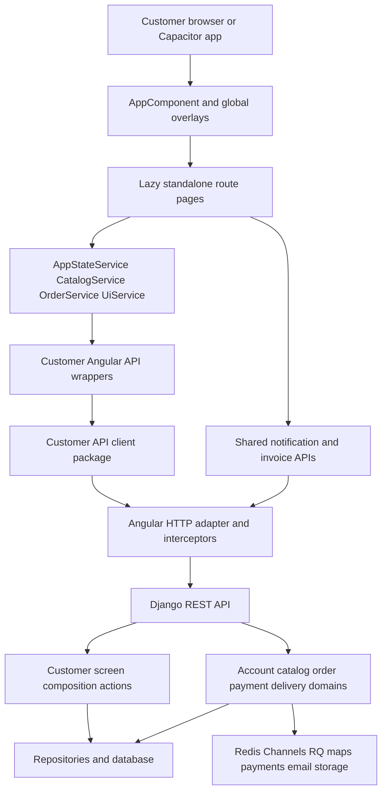
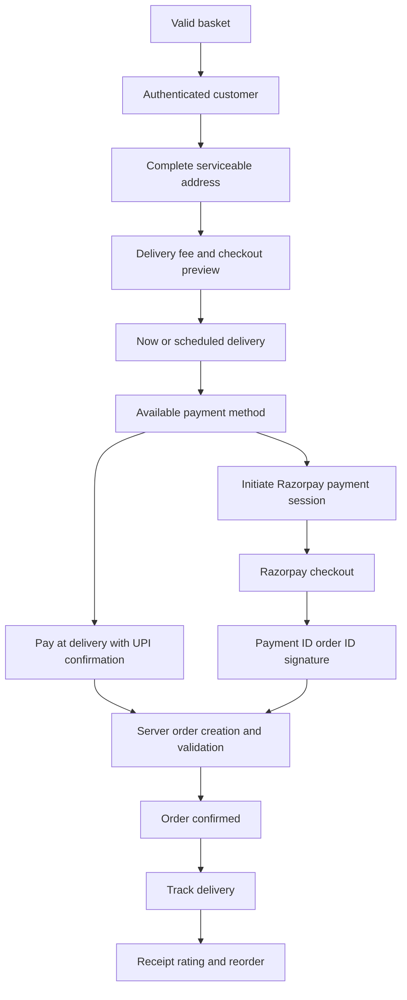

# Nextou Customer App End to End Analysis

**Analysis date:** 4 October 2026. **Repository:** `D:\Projects\NexConnect\shopping-app`.

The customer app implements a substantial shopping journey: choose a delivery location, discover nearby stores and products, build a guest or authenticated basket, sign in with OTP, manage addresses, review charges, pay, track delivery, download receipts, reorder, and rate an order. Its customer support, cancellation entry points, pack selection, and parts of filtering are incomplete or disconnected. Several checkout and navigation error paths need attention before this can be treated as a verified end-to-end experience.

This report describes the current source, rather than assuming that older architecture documents still reflect the implementation. It includes every route registration, the functionality of each implemented page, backend contracts, shared state, mobile behavior, concrete findings, and an end-to-end validation matrix.

## 1 Scope and evidence

Reviewed areas:

- Customer Angular app: `frontend/projects/customer-app/src`.
- Customer shared services, HTTP infrastructure, feature controls, maps, notifications, and native helpers: `frontend/projects/shared/src/lib`.
- Reusable customer domain packages: `packages/customer-*`.
- Relevant Django customer, account, catalog, basket, checkout, payment, order, delivery, notification, and invoice routes and implementations.
- Capacitor customer wrapper and active Angular build configurations.

Source snapshot:

| Repository | HEAD inspected |
|---|---|
| Parent repository | `53b823f` |
| Frontend submodule | `e13d09d` |
| Backend submodule | `c0cefa6` |

There were already unrelated modifications in the parent repository. The analysis did not change application source, commit submodules, or deploy anything.

**Evidence level:** source analysis plus compilation and Django system checks. No authenticated browser purchase, real OTP delivery, gateway transaction, live driver session, physical-device test, accessibility audit, or production network audit was performed. Features described as implemented have visible code and API connections; this is not a claim that each feature passed runtime E2E testing. Findings below distinguish direct code behavior from risks requiring reproduction.

## 2 Inventory and overall coverage

| Inventory item | Count or result |
|---|---|
| Angular route entries | 41, including wildcard |
| Route entries loading a component | 21 |
| Redirect entries | 20, including wildcard |
| Unique customer page components | 18 |
| Additional shared routed screen | Feature unavailable |
| Customer app component files | 56, including root, pages, shared UI, cards, and mobile UI |
| Customer package directories | 21 |
| Standalone customer login page | Absent; login uses a global slider |
| Active customer wallet, wishlist, referral, or issue pages | Absent from the router |

There are 26 directories beneath `pages`, but only 18 contain customer page component source files. Directory names such as `wallet`, `wishlist`, `offers`, `help`, and `issues` must not be counted as implemented screens merely because the directories exist.

| Capability | Current coverage |
|---|---|
| Location and nearby availability | Implemented, with differing error policies between guard and state service |
| Home, categories, stores, search | Implemented; some filters and routing transitions are incomplete |
| Store and product details | Implemented; product variants are display state only |
| Guest basket | Implemented with browser persistence |
| Account basket and guest merge | Implemented with store and fulfillment conflict prompts |
| Login and new customer onboarding | Unified phone/email OTP flow; backend can create a new customer on verification |
| Address and profile management | Implemented |
| Checkout and server charge preview | Implemented; retry and async-ordering issues found |
| Online payment | Razorpay adapter and server payment verification implemented |
| Pay at delivery | Implemented as `cod`, with explicit UPI-at-delivery confirmation |
| Scheduled delivery | Manual date/time entry implemented; slot availability API not consumed by checkout page |
| Order history and tracking | Implemented; pagination and invalid-order states need attention |
| Receipts and ratings | Implemented |
| Notifications | Implemented; login-in-place and error states need attention |
| Customer cancellation | API/service implemented; visible tracking links do not invoke it |
| Customer issue creation and chat | Backend/client capabilities exist; active customer screens are disconnected |
| Wallet, loyalty, wishlist, referrals | Backend/client capabilities exceed the active customer UI |

## 3 Runtime and architecture

The active monorepo manifest pins Angular runtime packages to **21.2.25**, Angular CLI/build tooling to **21.2.24**, TypeScript to **~5.9.3**, and RxJS to **~7.8.0**. The repository guidance calls the frontend Angular 19, while the nested customer app manifest still declares Angular 18.2.x. Use the root frontend manifest and `frontend/angular.json` for the build analyzed here.

Sources: [frontend manifest](D:/Projects/NexConnect/shopping-app/frontend/package.json), [nested manifest](D:/Projects/NexConnect/shopping-app/frontend/projects/customer-app/package.json), [Angular workspace](D:/Projects/NexConnect/shopping-app/frontend/angular.json).



### Bootstrap and environment

`main.ts` bootstraps standalone `AppComponent`, supplies router scroll restoration, HTTP interceptors, `API_BASE_URL`, `AUTH_PREFIX = customer`, animations, and map runtime configuration.

| Build | API base | Router base |
|---|---|---|
| Development | `/api` | `/` |
| Production | `/sa/api` | `/` in production configuration |
| Mobile | `https://www.nex-connect.in/sa/api` | `./` |
| Base build options before configuration override | Environment-dependent | `/sa/` |

The desktop SPA path and API path are separate. A production API under `/sa/api` does not mean the current production SPA build necessarily uses `/sa/` as its router base. Hosting rewrite rules must match the actual build configuration.

The development server uses `proxy.conf.js`. Runtime map settings come from `window.__NEXCONNECT_CONFIG__` with environment fallbacks. Google Maps key availability and domain restrictions were not validated against the provider.

Source: [bootstrap](D:/Projects/NexConnect/shopping-app/frontend/projects/customer-app/src/main.ts).

### State and API layers

| Service or layer | Responsibility |
|---|---|
| `AppStateService` | Basket, addresses, payment methods, location, availability, fulfillment lock, coupons, charge preview, checkout submission, active order, and local toasts |
| `CatalogService` | Categories, stores, products, home/explore payloads, recommendations, banners, coupons, store pagination, normalization, and local caches |
| `OrderService` | Auth-reactive order list, order detail cache, order placement, reorder, cancellation, rating API orchestration |
| `UiService` | Global login, location, edit, filter, mini-cart, and confirmation overlays |
| Customer `AuthService` | OTP UI state and customer profile presentation over shared authentication |
| `CustomerAppStartupService` | Content config, feature config, feature polling, notification polling, and startup/splash loaders |
| `CustomerContentConfigService` | Server-configurable copy, promotions, navigation, search tabs, filters, and fallback content |
| `CustomerCatalogApiService` | Home, availability, discovery, product, vendor, and recommendation requests |
| `CustomerCartApiService` | Basket, suggestions, coupons, checkout preview, payment initiation, order creation, and shared basket count |
| `CustomerAccountApiService` | Profile, addresses, and payment-method requests |
| `CustomerOrderApiService` | Order reads, tracking, reorder, cancel, rate, and invoice adapters |
| `CustomerApiClientService` | Promise client construction and conversion to RxJS Observables |
| Angular and browser adapters | HTTP error conversion, token storage integration, and Razorpay browser checkout |
| Domain facades | Narrow basket, checkout, location, order, and UI accessors; many pages still directly depend on the large state service |

Business utilities are shared through customer core, cart, checkout, pricing, location, validation, products, orders, auth, search, offers, errors, and related packages. The 21 packages are not 21 independently implemented UI features: some provide contracts or utilities, while others expose features that the router does not currently surface.

### Global shell and navigation

The root shell provides desktop topbar, mobile topbar, route outlet, startup/page/API loaders, desktop/shared toasts, mobile toasts, a mobile bottom nav, and deferred global overlays.

The standard mobile navigation is **Home, Stores, Search, Cart, Account**. Orders, addresses, notifications, offers, and policy are reached through Account or contextual links. The mobile topbar is hidden on Explore, where the page owns search chrome.

The active-order shortcut is shown on Home. The mobile basket assist is selected for store detail, product detail, and categories routes. It is not enabled for every shopping route. Global sheets are instantiated with `@defer` after their opening conditions first become true.

Sources: [root component](D:/Projects/NexConnect/shopping-app/frontend/projects/customer-app/src/app/app.component.ts), [root template](D:/Projects/NexConnect/shopping-app/frontend/projects/customer-app/src/app/app.component.html), [navigation](D:/Projects/NexConnect/shopping-app/frontend/projects/customer-app/src/app/config/customer-navigation.ts).

## 4 Complete route inventory

Routes below are logical Angular paths. Apply the selected build's router base when constructing externally hosted links.

Guard notation:

- **F:** `pageFeatureRouteGuard('customer-app')`.
- **L:** `customerLocationGuard`.
- **A:** `customerAuthGuard`, which requires an authenticated customer role.
- **UI login:** the route is enterable by a guest but shows a locked/sign-in state in its template.

### Component routes

| Route | Loaded component | Guards | Function |
|---|---|---|---|
| `/feature-unavailable` | Shared `PageFeatureUnavailableComponent` | None | Feature-disabled fallback |
| `/location` | `LocationComponent` | None | Delivery area selection and serviceability |
| `/` | `HomeComponent` | F, L | Home discovery and active order entry |
| `/categories` | `CategoriesComponent` | F, L | Category directory and filtered products |
| `/explore` | `SearchComponent` | F, L | Search and mixed discovery |
| `/explore/:categoryId` | `SearchComponent` | F, L | Category-scoped Explore registration |
| `/stores` | `StoresComponent` | F, L | Dedicated store listing |
| `/category/:id` | `CategoryComponent` | F, L | Dedicated category detail |
| `/store/:id` | `StoreDetailComponent` | F, L | Store catalog and availability |
| `/product/:id` | `ProductDetailComponent` | F, L | Product detail and purchase actions |
| `/cart` | `CartComponent` | F, L | Guest or account basket |
| `/checkout` | `CheckoutComponent` | F, L; UI login | Address, delivery timing, payment, review |
| `/orders` | `OrdersComponent` | F; UI login | Order history and reorder |
| `/order-confirmed/:id` | `OrderConfirmedComponent` | F, A | Order confirmation summary |
| `/tracking/:id` | `TrackingComponent` | F, A | Timeline, location, ETA, partner, receipt |
| `/order-finished/:id` | `OrderFinishedComponent` | F, A | Completed-order details, rating, receipt, reorder |
| `/order/:id/rating` | `OrderFinishedComponent` | F, A | Registered rating alias; earlier redirect precedence needs validation |
| `/account` | `ProfileComponent` | F; UI login | Account hub and profile editing |
| `/addresses` | `AddressesComponent` | F; UI login | Saved address CRUD and selection |
| `/notifications` | `NotificationsComponent` | F; UI login | Notification list and read actions |
| `/privacy-policy` | `PrivacyPolicyComponent` | F | Static customer privacy information |

### Redirect routes

| Registered route | Declared destination | Meaning or limitation |
|---|---|---|
| `/new-home` | `/` | Old home URL |
| `/search` | `/explore` | Search alias |
| `/completed-order/:id` | `/order-finished/:id` | Completed-order alias |
| `/order/:id` | `/tracking/:id` | Order detail alias; default prefix matching |
| `/order/:id/tracking` | `/tracking/:id` | Tracking alias; follows broader order redirect |
| `/profile` | `/account` | Account alias |
| `/privacy` | `/privacy-policy` | Policy alias |
| `/wishlist` | `/account` | No active wishlist page |
| `/favorites` | `/account` | No active favorites page |
| `/wallet` | `/account` | No active wallet page |
| `/payments` | `/account` | No standalone payment-management page |
| `/offers` | `/explore` | No dedicated offers page or automatic offers filter |
| `/referral` | `/account` | No active referral page |
| `/help` | `/account` | No help-center page |
| `/issues` | `/account` | No issue-list page |
| `/my-issues` | `/account` | No issue-list page |
| `/order/:id/issue` | `/account` | No issue-creation page; earlier order prefix redirect may interfere |
| `/issue/:issueId` | `/account` | No issue detail/chat page |
| `/login` | `/` | Does not itself open the login slider |
| `/**` | `/` | Unknown route fallback; no dedicated 404 page |

The earlier `/order/:id` redirect has no `pathMatch: 'full'`. Later paths sharing that prefix should not be assumed reachable just because they appear in the route file. The table records declarations; prefix-alias behavior is a separate finding below.

Source of truth: [route definitions](D:/Projects/NexConnect/shopping-app/frontend/projects/customer-app/src/app/app.routes.ts).

### Route access behavior

The location guard restores or initializes a location without prompting and redirects to `/location?returnUrl=<requested URL>` only when coordinates are absent. Its serviceability request has a **1.8-second timeout**, and request errors are replaced with `is_serviceable: true`. An explicit unavailable response clears the deliverable catalog, but the guard still returns `true` so the page can render the unavailable state.

The state service has a stricter policy: a failed serviceability request clears the catalog and marks delivery unavailable. These concurrent policies can produce inconsistent transient behavior.

The customer auth guard clears a session with a different role, opens the login slider, and redirects to Home. It has a Cart fallback for Checkout, although Checkout currently does not register this guard. It does not preserve the requested order URL for automatic post-login return.

Feature configuration polls every **30 seconds**, refreshes on focus/visibility, and defaults to allowing routes if configuration cannot be loaded. A disabled matched route or maintenance mode leads to the feature-unavailable screen. Location and feature-unavailable remain directly accessible.

Sources: [location guard](D:/Projects/NexConnect/shopping-app/frontend/projects/customer-app/src/app/services/customer-location.guard.ts), [auth guard](D:/Projects/NexConnect/shopping-app/frontend/projects/customer-app/src/app/services/customer-auth.guard.ts), [feature access](D:/Projects/NexConnect/shopping-app/frontend/projects/shared/src/lib/services/page-feature-access.service.ts).

## 5 Page functionality

### Location

**Route:** `/location`.

Supports current location, a saved address, a shared map picker, and manual coordinates with address/city/state/PIN metadata. The map starts from address or entered coordinates, otherwise Bengaluru coordinates. Continuing requires the state service to report a serviceable location and returns to the URL carried in `returnUrl`.

Location choices refresh home, categories, stores, serviceability, and basket fulfillment reconciliation through `AppStateService`. Automatic continuation uses fixed delays of 300, 500, or 900 ms rather than awaiting a particular availability response. Manual validation only checks numeric finiteness; empty strings convert to zero.

Source: [LocationComponent](D:/Projects/NexConnect/shopping-app/frontend/projects/customer-app/src/app/pages/location/location.component.ts).

### Home

**Route:** `/`.

Shows a hero/banner, categories, nearby open stores, product rails, offers, promotions, and a shortcut to the active order. Product sections include buy-again/recently ordered, trending, new arrivals, best sellers, and flash deals. It removes unavailable products/stores using server fields and local availability checks.

The home composition API supplies hero, recommendations, flash deals, buy-again products, and sections. Some displayed rails are calculated locally using sales, rating, dates, discounts, or current basket categories. If buy-again data is empty, the recently ordered rail can fall back to basket matches or the general pool; it is not always actual purchase history. The four quick actions currently all navigate to `/explore` without distinct query filters.

Source: [HomeComponent](D:/Projects/NexConnect/shopping-app/frontend/projects/customer-app/src/app/pages/home/home.component.ts).

### Categories

**Route:** `/categories`, optionally `?category=<key>`.

Displays category choices and products, subcategory chips, availability filters (All/In stock/Instant delivery), relevance/price/ETA sorting, and matching store counts. Instant filtering uses a parsed ETA threshold of 45 minutes. Category selection updates the URL and requests product data. Category keys accept normalized identifiers/labels/slugs.

The all-categories product source is a top-12 slice. Selected-category filtering contains an unconditional match against the selected category itself, which can retain products from other categories in the merged product pool. This is a concrete correctness finding.

Source: [CategoriesComponent](D:/Projects/NexConnect/shopping-app/frontend/projects/customer-app/src/app/pages/categories/categories.component.ts).

### Category detail

**Route:** `/category/:id`.

Loads category products, presents category title and chips, supports price/rating ordering, store counts, product cards, and back navigation. It subscribes to parameter changes and cleans up that subscription. Unlike the broader Categories page, its product filter directly compares each product's category to the requested key.

The Popularity default preserves the existing list order; only price and rating have explicit client sort branches. This page and Categories construct location queries from the active saved address rather than the shared guest/manual location fallback.

Source: [CategoryComponent](D:/Projects/NexConnect/shopping-app/frontend/projects/customer-app/src/app/pages/category/category.component.ts).

### Stores

**Route:** `/stores`, optionally `?category=<key>`.

Provides a dedicated nearby-store list, category filters, name/location/category text search within loaded stores, rating/delivery-time sort, promotion content, location picker entry, and Load More. Server queries use a page size of 12 by default. Store pagination follows the returned `next` URL.

The View Map action opens the delivery location picker and displays a message; it does not present a map containing all stores. Its page query builder uses saved-address coordinates and does not fall back to the guest's shared location.

Source: [StoresComponent](D:/Projects/NexConnect/shopping-app/frontend/projects/customer-app/src/app/pages/stores/stores.component.ts).

### Explore and search

**Routes:** `/explore`, `/explore/:categoryId`; query parameters `q` and `category`.

Provides All/Stores/Products/Categories tabs, counts, search input, category scope, promotions, quick filters, sort, recent searches, trending terms, and recommended browse sections. Search requests are delayed by 250 ms. Recent searches persist locally, are limited to eight, and can be removed individually or cleared. Selecting a store carries the search query to its catalog through `?q=`.

Without a query, browse stores are limited to eight and products to twelve. Recent/trending suggestions are partly category-derived, with hardcoded term fallbacks. Quick filters update chips and tabs but do not apply their stated numeric constraints. The debounce effect tracks the query before its timer; category and sorting values are read inside the timer, so changing only those values does not reliably issue a new request. Requests already sent are not cancelled by the debounce timer.

Source: [SearchComponent](D:/Projects/NexConnect/shopping-app/frontend/projects/customer-app/src/app/pages/search/search.component.ts).

### Store detail

**Route:** `/store/:id`, optionally `?q=<product query>`.

Displays store metadata, ETA, running offer, category groups, stock counts, opening/closing status, location action, share/copy action, and available products. Store search, category, and product sorting are sent to vendor detail using `product_search`, `product_category`, and `product_sort`. Product groups are limited to twelve items each.

An unavailable, closed, non-accepting, or unserviceable store shows a reason and prevents ordering. Share uses native browser sharing when available, with clipboard fallback. The generated URL is rooted at `location.origin + /store/<id>`; it does not account for a deployment under a subpath.

Source: [StoreDetailComponent](D:/Projects/NexConnect/shopping-app/frontend/projects/customer-app/src/app/pages/store-detail/store-detail.component.ts).

### Product detail

**Route:** `/product/:id`.

Displays product image, price/MRP/discount, unit and pack choices, quantity, stock and low-stock state, store/ETA, highlights, and Add to Cart/Buy Now. Detail panels adapt to grocery, food, beverages, personal care, home care, medicine, or general merchandise. Data can include ingredients, allergens, shelf life, refrigeration, fragile/perishable flags, packaging, returnability, and restrictions. The reviews panel presents aggregate rating information rather than a fetched review thread.

Recommendations include similar products from the same store and other stores, ranked using rating, unit, delivery ETA, and price proximity. Purchase eligibility checks stock and store availability. Quantity increases are not capped by stock in this component. Pack choice changes only `selectedSize`; it does not select a different SKU, change the submitted product, or pass a variant to the basket API. Image zoom currently displays a toast.

Source: [ProductDetailComponent](D:/Projects/NexConnect/shopping-app/frontend/projects/customer-app/src/app/pages/product-detail/product-detail.component.ts).

### Cart

**Route:** `/cart`.

Shows basket items and quantities, removal, store status, delivery/minimum-order information, charge summary, coupon input, best-coupon action, suggestions, and checkout entry. Guests can edit their locally saved basket; applying a coupon and proceeding to checkout require sign-in.

Authenticated nonempty baskets request same-store/frequently-bought-together suggestions and the best eligible coupon. These enhancements are loaded in `ngOnInit`; they do not automatically refresh when the customer signs in or changes basket eligibility while staying on the page. Core charges and basket signals are reactive independently.

Source: [CartComponent](D:/Projects/NexConnect/shopping-app/frontend/projects/customer-app/src/app/pages/cart/cart.component.ts).

### Checkout

**Route:** `/checkout`; guest locked state.

Supports complete address selection, address-specific delivery quotes, fee-change confirmation, immediate/scheduled delivery, payment methods from platform configuration, UPI app selection, charge review, suggested additions, and final order submission. Desktop and mobile layouts coexist. Mobile sections are Address, Slot, Payment, Review; the primary action from Address jumps directly to Payment, while Slot remains separately selectable.

Address requirements include receiver details, street/address line, city, state, and PIN. A different-state or explicitly unserviceable quote blocks the address. Scheduled time must exceed the vendor preparation buffer and fall within configured opening/closing times. The UI date maximum is seven days. It does not use the available-slots response, so displaying a valid date/time does not establish that a server capacity slot is available. Scheduling remains blocked while the store is currently closed.

The final action blocks empty baskets, mixed stores, stale/mismatched fulfillment areas, store minimum shortfalls, unavailable stores, invalid addresses/times, or unavailable payment methods. Choosing `cod` displays a confirmation that payment at delivery must use UPI. Selecting any named UPI app sets the common `razorpay_upi` method; the adapter does not pass that specific app as a gateway restriction.

Sources: [CheckoutComponent](D:/Projects/NexConnect/shopping-app/frontend/projects/customer-app/src/app/pages/checkout/checkout.component.ts), [checkout state](D:/Projects/NexConnect/shopping-app/frontend/projects/customer-app/src/app/services/app-state.service.ts:1215), [payment adapter](D:/Projects/NexConnect/shopping-app/frontend/projects/customer-app/src/app/services/adapters/browser-payment.adapter.ts).

### Orders

**Route:** `/orders`; guest locked state.

Lists loaded orders with All/Active/Delivered/Cancelled tabs, client-side text search, status labels, order/item/payment details, tracking/completion links, and reorder. Refunded orders join the Cancelled bucket. Order data loads reactively when authentication changes, and retry reloads it.

Counts and spend calculations are based on the loaded order array, not the backend's full customer summary. The date-range action only displays a recent-orders toast. No page-navigation/load-more controls are implemented here.

Source: [OrdersComponent](D:/Projects/NexConnect/shopping-app/frontend/projects/customer-app/src/app/pages/orders/orders.component.ts).

### Order confirmation

**Route:** `/order-confirmed/:id`; authenticated customer.

Fetches the customer confirmation payload by UUID and shows order summary, total, status, store, and contextual next actions. Includes loading and failure states. It uses `/customer/orders/<id>/confirmation/`, rather than assembling the screen solely from the generic order list.

Source: [OrderConfirmedComponent](D:/Projects/NexConnect/shopping-app/frontend/projects/customer-app/src/app/pages/order-confirmed/order-confirmed.component.ts).

### Tracking

**Route:** `/tracking/:id`; authenticated customer.

Combines order details with status history, live driver coordinates, ETA, freshness/error labels, partner photo/contact, receipt download, and retry. The condensed progress bar displays Placed/Confirmed/Preparing/On the way or Delivered. Full timeline entries retain more granular statuses.

REST refresh runs every 30 seconds until delivered, cancelled, or refunded. The WebSocket reconnect delay is five seconds. Socket messages currently update location or ETA, while order status still refreshes through REST. Embedded Google Maps is intentionally disabled on localhost and requires a configured key elsewhere. Before pickup, the marker favors the store; after pickup, it favors the driver and destination. Directions can open Google Maps externally.

The displayed help/delayed/missing-item/cancel links do not connect to active issue screens. The Cancel Order label is a link to `/order/<id>/issue`, not a call to `cancelOrder()`. The map control handler opens directions rather than changing map zoom.

Source: [TrackingComponent](D:/Projects/NexConnect/shopping-app/frontend/projects/customer-app/src/app/pages/tracking/tracking.component.ts), [tracking template](D:/Projects/NexConnect/shopping-app/frontend/projects/customer-app/src/app/pages/tracking/tracking.component.html:215).

### Order finished and rating

**Routes:** `/order-finished/:id`, registered `/order/:id/rating` alias.

Shows order details/timeline, vendor rating/comment, delivery rating/comment when a partner exists, next-order coupon, receipt download, and reorder. Rating submission is guarded against concurrent clicks and checks a returned `has_rating` flag. It generates a customer receipt if no invoice ID is known, then downloads its PDF.

The route itself does not enforce delivered status; backend validation must reject premature or unauthorized ratings. A successful rating mutates the nested raw flag directly rather than replacing the signal-held order. Coupon-copy success is announced without awaiting clipboard success.

Source: [OrderFinishedComponent](D:/Projects/NexConnect/shopping-app/frontend/projects/customer-app/src/app/pages/order-finished/order-finished.component.ts).

### Account

**Route:** `/account`; guest locked state.

Shows profile summary, membership date, loaded order count, profile/address edit entry points, logout, and links to Orders, Addresses, Cart, Notifications, Explore offers, and Privacy Policy. Wishlist and Wallet are explicitly disabled with coming-soon text. Help points toward Orders rather than an active support center. No separate saved-payment screen is implemented.

The customer-facing profile adapter sets delivered-order fallback count to zero and Prime membership to false; these values do not indicate a functioning subscription or loyalty UI.

Source: [ProfileComponent](D:/Projects/NexConnect/shopping-app/frontend/projects/customer-app/src/app/pages/profile/profile.component.ts).

### Addresses

**Route:** `/addresses`, with `?add=1` to open creation; guest locked state.

Provides add, edit, delete, select/default address, map picker, and a mobile bottom sheet. Validates label, receiver name, Indian mobile number, address line, city, state, and a six-digit PIN. It sanitizes input and maps backend validation fields to per-field messages.

Default selection immediately changes local state and sends an update when raw backend address data exists. That update's failure is ignored, so the UI can announce a successful default change that was not persisted. Coordinates can be populated by the map, but the form validator itself does not require them.

Source: [AddressesComponent](D:/Projects/NexConnect/shopping-app/frontend/projects/customer-app/src/app/pages/addresses/addresses.component.ts).

### Notifications

**Route:** `/notifications`; guest locked state.

Shows normalized notifications, timestamps, read status, Mark All Read, and contextual order navigation. Opening an unread notification marks it read and refreshes the shared unread count. Notifications without an order go to Orders.

The page only loads in its constructor when already signed in. Signing in through the slider while staying on this screen does not trigger a new list request. API errors become an empty list, and there are no visible pagination or dedicated retry/error controls in the component.

Source: [NotificationsComponent](D:/Projects/NexConnect/shopping-app/frontend/projects/customer-app/src/app/pages/notifications/notifications.component.ts).

### Privacy policy

**Route:** `/privacy-policy`.

Static policy sections cover account, location, shopping, notifications, sharing, storage, customer choices, and restricted products. The displayed update date is 30 June 2026. Some prose mentions cancellation and support capabilities more broadly than the active customer UI currently exposes. This analysis assesses implementation consistency only; it is not a legal assessment of the policy.

Source: [PrivacyPolicyComponent](D:/Projects/NexConnect/shopping-app/frontend/projects/customer-app/src/app/pages/privacy-policy/privacy-policy.component.ts).

### Feature unavailable

**Route:** `/feature-unavailable`.

Shared fallback for administrator-disabled routes. It is outside the 18 local customer page components. Access depends on runtime configuration, so a successfully compiled page can still be intentionally inaccessible.

## 6 Customer journeys from entry to completion

### First visit and guest shopping

1. Bootstrap restores available session/location state and requests content/feature config.
2. Entering a location-guarded route with no coordinates sends the customer to Location with a return URL.
3. Location choice requests delivery serviceability and refreshes nearby catalog data.
4. The customer discovers products through Home, Categories, Stores, Explore, or a direct detail URL.
5. Guest Add to Cart stores normalized items and fulfillment metadata in local storage.
6. Adding from a different store or fulfillment area prompts replacement rather than silently mixing baskets.
7. The guest can adjust quantities and remove items; coupon application and checkout entry open login.

### OTP sign-in and account creation

1. The global slider collects a mobile number and email; both are required in this UI.
2. It calls the mobile login OTP request endpoint. The backend uses email delivery, including a queue with direct-send fallback.
3. The customer enters a four-to-eight-digit OTP in the UI. Backend OTP expiry, resend cooldown, and request limits remain authoritative.
4. Verification returns a customer session. For a new eligible phone/email combination, the backend can create a customer in this login flow.
5. Profile bootstrap validates the session, merges a guest basket, and loads addresses, payment methods, and the active order. OrderService separately loads orders.
6. Successful login closes the slider. The interrupted action is not automatically replayed in all contexts; for example, Cart checkout must be chosen again.

The backend declares a 60-second resend cooldown and request limits within a 15-minute window; the slider does not display a resend countdown. The UI exposes neither a customer password login screen nor a separate registration screen.

Sources: [login slider](D:/Projects/NexConnect/shopping-app/frontend/projects/customer-app/src/app/shared/login-slider/login-slider.component.ts), [customer auth wrapper](D:/Projects/NexConnect/shopping-app/frontend/projects/customer-app/src/app/services/auth.service.ts), [backend OTP actions](D:/Projects/NexConnect/shopping-app/backend/accounts/actions/auth_actions.py).

### Guest basket synchronization

Guest items are replayed one at a time to the backend basket. A store/fulfillment conflict prompts Keep saved basket or Replace basket. Guest storage is cleared once the replay reaches completion. A non-conflict failure stops synchronization while retaining guest storage. Because successful intermediate items are not removed individually, retrying after partial success can replay already-added quantities; this requires a failure-injection test.

### Checkout and payment



The charge preview is server-led and can include platform fee, packaging/handling, small-cart fee, tax, surge, discounts, and final payable. The client has a fallback subtotal/delivery/handling/coupon calculation, which does not reconstruct every server fee. Failed previews currently clear the server breakup instead of definitively blocking submission.

For online payment, initiation occurs before application order creation. The browser opens Razorpay, then sends the returned payment proof with the final create-order request. The server checks signature, locks the customer's payment session, compares the created total to the payment amount, and can return already-linked paid-session orders. The backend supports a client idempotency key, but the current customer submission does not supply one.

For pay-at-delivery, create-order is called directly after the explicit UPI confirmation. A failed request currently does not reset the submission flag in this branch.

Sources: [frontend placement flow](D:/Projects/NexConnect/shopping-app/frontend/projects/customer-app/src/app/services/app-state.service.ts:1215), [create-order view](D:/Projects/NexConnect/shopping-app/backend/orders/views/create_order_views.py), [order creation action](D:/Projects/NexConnect/shopping-app/backend/orders/actions/ordering/create_orders.py).

### Fulfillment and delivery

The customer places and watches the order; preparation and driver assignment are controlled by vendor/delivery workflows. Driver search is vendor-initiated. Creation alone does not start a driver search. Therefore, a customer ETA or confirmation is not proof that a partner is assigned.

Tracking shows the available order state and partner information, receives location/ETA socket messages, and polls for status changes. Delivered/cancelled/refunded states stop tracking refresh. Receipts can be requested from Tracking or Order Finished, and vendor/delivery ratings are submitted from Order Finished.

### Reorder and post-purchase help

Reorder calls the backend action, reloads the basket, opens mini-cart, and displays a success message. The final basket still needs validation for changed stock, store status, prices, location, fulfillment area, and conflicts.

Help and cancellation are the weakest connected portion of the journey: APIs exist, but the active customer routing does not provide issue creation or chat, and Cancel Order is not wired to the cancellation action.

## 7 API contract map

Paths in this section are appended to the configured API base (`/api`, `/sa/api`, or the mobile absolute URL). UUID values occupy `<id>` placeholders. Methods reflect the current client and views inspected.

### Authentication and addresses

| Method | Path | Customer use |
|---|---|---|
| POST | `/auth/mobile/request-login-otp/` | Request phone/email OTP |
| POST | `/auth/mobile/verify-login-otp/` | Verify OTP and establish customer session |
| POST | `/auth/refresh/` | Session renewal |
| POST | `/auth/logout/` | Session logout |
| GET / PUT | `/auth/profile/` | Current client profile bootstrap/edit |
| GET / POST | `/auth/addresses/` | List/create addresses |
| PUT / DELETE | `/auth/addresses/<id>/` | Current client edit/delete/default selection |

The API client also exposes register OTP and password-reset capabilities. Their existence does not mean the customer slider surfaces those separate flows.

### Discovery and screen composition

| Method | Path | Customer use |
|---|---|---|
| GET | `/customer/home/` | Composed hero, stores, recommendations, offers, buy-again, sections |
| GET | `/customer/location/serviceability/` | Delivery availability, node, promise, ETA |
| GET | `/customer/explore/` | Combined products/stores/categories/offers |
| GET | `/customer/buy-again/` | Available client capability; home also receives buy-again composition |
| GET | `/products/categories/` | Visible active categories |
| GET | `/products/list/` | Product listing/filtering |
| GET | `/products/<id>/` | Product detail |
| GET | `/products/search-by-location/` | Location product-search capability |
| GET | `/vendors/list/` | Store discovery, paging, and global-item search capability |
| GET | `/vendors/list/?search_mode=nearby` | Current client's nearby-vendor capability; backend also exposes `/vendors/nearby/` |
| GET | `/vendors/<id>/` | Store details and filtered nested products |
| GET | `/vendors/<id>/recommendations/` | Store recommendation pool |
| GET | `/orders/banners/` | Promotional banners |
| GET | `/orders/coupons/` | Customer coupons |
| GET | `/orders/customer-app/content-config/` | Copy, promotions, navigation, filters |
| GET | `/orders/page-features/` | Runtime page/feature access configuration |

Common discovery inputs include `lat`, `lng`, `state`, `city`, `postal_code`, category, search, sort, and pagination. The customer composition namespace also exposes aliases for store/product/cart/order operations. The active API-client endpoint table largely uses canonical domain paths for these mutations rather than switching everything to `/customer/*`.

### Basket and checkout

| Method | Path | Customer use |
|---|---|---|
| GET | `/orders/cart/` | Authenticated basket |
| POST | `/orders/cart/add/` | Add product/quantity and fulfillment context |
| PATCH / DELETE | `/orders/cart/items/<id>/` | Change quantity/remove line |
| POST | `/orders/cart/replace/` | Replace conflicting basket |
| POST | `/orders/cart/fulfillment/` | Refresh fulfillment lock |
| POST | `/orders/cart/fulfillment/events/` | Record fulfillment reconciliation events |
| DELETE | `/orders/cart/clear/` | Clear basket |
| GET | `/customer/cart/suggestions/` | Same-store/frequently bought suggestions |
| GET | `/customer/cart/apply-best-coupon/` | Find eligible best coupon; application uses validation endpoint |
| POST | `/orders/coupons/validate/` | Validate code, basket total, address |
| GET | `/orders/delivery-fee-preview/?address_id=<id>` | Address delivery quote |
| POST | `/orders/checkout-preview/` | Authoritative charge preview |
| GET | `/orders/payment-methods/` | Platform-enabled payment choices |
| GET | `/customer/checkout/slots/` | Exposed wrapper; not consumed by current checkout page |
| POST | `/orders/initiate-checkout-payment/` | Pre-order payment session |
| POST | `/orders/create/` | Final order creation with payment proof when online |

### Orders and post-purchase

| Method | Path | Customer use |
|---|---|---|
| GET | `/orders/list/` | Customer order history |
| GET | `/orders/<id>/` | Owned order details |
| GET | `/orders/<id>/tracking/` | Tracking records |
| GET | `/customer/orders/active/` | Active-order Home shortcut |
| GET | `/customer/orders/<id>/confirmation/` | Confirmation screen |
| POST | `/orders/<id>/reorder/` | Refill basket |
| POST | `/orders/<id>/rate/` | Vendor and delivery ratings |
| POST | `/orders/<id>/cancel/` | Client/service capability, currently not reached by visible Cancel Order link |
| POST | `/invoices/generate/` | Generate customer receipt |
| GET | `/invoices/<id>/download/` | PDF receipt blob |
| GET | `/notifications/list/` | Notification feed |
| PATCH | `/notifications/<id>/read/` | Mark one read |
| POST | `/notifications/mark-all-read/` | Mark all read |
| GET | `/notifications/unread-count/` | Badge polling |
| POST | `/notifications/device-token/` | Native push token registration through shared auth infrastructure |

WebSocket: `/ws/delivery/<order-id>/tracking/`, with the API prefix resolved appropriately for production. Authentication is passed in WebSocket subprotocols `[nexconnect.jwt, <JWT>]`. Current backend middleware reads the same protocol. The repository guidance describing `?token=` authentication is stale for this implementation.

Sources: [client endpoint definitions](D:/Projects/NexConnect/shopping-app/packages/customer-api-client/src/index.ts), [customer aliases](D:/Projects/NexConnect/shopping-app/backend/backend/routes/customer.py), [order routes](D:/Projects/NexConnect/shopping-app/backend/orders/urls.py), [WebSocket helper](D:/Projects/NexConnect/shopping-app/frontend/projects/shared/src/lib/services/websocket-auth.ts), [WebSocket middleware](D:/Projects/NexConnect/shopping-app/backend/backend/middleware/ws_auth.py).

## 8 Models persistence and consistency

### Principal UI models

| Model | Key customer-facing fields |
|---|---|
| Category | ID, label, icon, image, raw category metadata |
| Store | ID, name, category, rating, ETA, distance, offer, delivery label, imagery, raw availability |
| Product | ID/API ID, name, unit, price, MRP, discount, image, category, rating, store ID/name, raw product fields |
| CartItem | Product data plus quantity, subtotal, backend cart-item ID and raw line |
| Address | ID, label, receiver, line, phone, city/state/PIN, coordinates, default state |
| PaymentMethod | ID, label, description, icon, default/selection state |
| Order | ID, date/time, amount, items, simplified status bucket, payment label, raw backend order |
| CustomerServiceability | Availability, store counts, ETA, nearest store, fulfillment node, expiring delivery promise |
| ActiveOrderSummary | Order number, status/payment status, store/address, total, tracking/cancel flags |

The normalized order model uses Active/Delivered/Cancelled buckets while retaining raw statuses. Screens need raw data for granular workflow decisions. Extensive `any`/raw-field access makes runtime contract changes difficult to detect solely through TypeScript compilation.

Source: [customer models](D:/Projects/NexConnect/shopping-app/frontend/projects/customer-app/src/app/models.ts).

### Browser persistence

| Storage | Purpose |
|---|---|
| `nextou.customer.guestCart.v1` in local storage | Guest items, store and fulfillment lock, promise/expiry, version/update timestamp |
| `nextou.customer.recent_searches` in local storage | Last eight search strings |
| Customer-prefixed session/local storage | Access token, supported refresh state, user cache; managed by shared auth/session store |
| Shared location storage | Restored/manual/current delivery location, address metadata |
| Session storage HTTP cache | Eligible GET response bodies, scoped by authorization hash |

`SessionStore` supports both session and local storage, but token presence/refresh-cookie behavior is determined by the shared auth implementation. Do not infer the active refresh mechanism solely from the generic API-client storage interface.

### Cache behavior

The HTTP cache selectively stores public/reference GETs for approximately two minutes or one minute, and some short-lived administrative/vendor requests for 15 seconds. Basket, order list/detail, profile, addresses, notifications, support, and invoices are excluded. Any non-GET clears the shared HTTP cache.

The cache only activates for normalized paths starting with `/api/`; production `/sa/api/...` paths miss that condition. Customer composition reads are also absent from its public-read allowlist. CatalogService still has separate local product/store caches, so this difference does not mean production has no caching.

Store list requests have a sequence check against stale responses. Explore, generic product reads, charge previews, and store-detail successful responses do not consistently apply equivalent cancellation/sequence protection. Merging product data keeps prior entries, which can influence later filtering and ranking.

Sources: [HTTP cache](D:/Projects/NexConnect/shopping-app/frontend/projects/shared/src/lib/interceptors/cache.interceptor.ts), [catalog service](D:/Projects/NexConnect/shopping-app/frontend/projects/customer-app/src/app/services/catalog.service.ts).

## 9 Mobile design and external dependencies

### Responsive presentation

The app uses separate desktop/mobile markup and reusable mobile components rather than a separate customer business application. A frequently used mobile breakpoint is 760 px. Shared tokens define safe-area-aware sticky controls, navigation heights, typography, cards, sheets, and toast layouts.

Current stylesheet tokens include purple `#7c3aed`, deep brand purple `#38268e`, orange `#f97928`, green `#16a34a`, white surfaces, and light backgrounds. These differ from the older primary `#6C63FF`/secondary `#FF6584` guidance. Inter and material-symbol icons appear in the implementation. Visual consistency, contrast, keyboard behavior, and small-screen clipping need rendered QA.

### Capacitor wrapper

Customer app ID is `com.nextou.customer`; the wrapper's web directory is the built Angular customer bundle. Android uses an HTTPS scheme, cleartext is disabled, and explicit navigation domains cover the application and Google map services. Splash, status-bar, keyboard, and push settings are configured.

Shared native helpers provide Capacitor geolocation and push registration. Shared auth attempts to register a device token after establishing a user session. These source paths do not establish that signing, Firebase configuration, device permissions, background notifications, or gateway handoff work on a physical device.

The wrapper has an offline fallback whose Retry navigates to `https://nex-connect.in/sa/`. The mobile API environment uses the `www` hostname. Offline recovery and redirects should be tested against the actual SPA hosting base; the offline fallback is not an offline purchasing mode.

Sources: [Capacitor config](D:/Projects/NexConnect/shopping-app/frontend/mobile-apps/customer-mobile/capacitor.config.ts), [offline wrapper behavior](D:/Projects/NexConnect/shopping-app/frontend/mobile-apps/customer-mobile/src/main.js), [native platform service](D:/Projects/NexConnect/shopping-app/frontend/projects/shared/src/lib/services/native-platform.service.ts).

### Dependency map

| Dependency | What it enables | Observable failure behavior or verification need |
|---|---|---|
| Django API and database | Catalog, account, basket, orders | Shared HTTP timeout is 15 seconds; individual screens vary in errors/retry |
| Redis and RQ | Assignment jobs, OTP queue, background operations | Django local smoke settings stub RQ; smoke success does not verify workers |
| Channels/ASGI and proxy upgrades | Live driver tracking | Five-second reconnect and 30-second REST fallback |
| Google Maps/Places and browser/native location | Map picking, geocoding, tracking map | Localhost tracking map intentionally disabled; permissions/config must be tested |
| Razorpay script and backend credentials/webhook | Online checkout and payment reconciliation | Cancellation is currently reported through a generic unavailable message |
| Email provider | Customer OTP and account emails | Queue/direct-send code exists; deliverability not tested |
| Invoice generation and storage | Customer PDF receipts | Frontend generates then downloads; PDF output not inspected in this audit |
| Native push provider and device setup | Customer push notifications | Token registration implemented; device behavior not tested |
| Browser clipboard/share/dialer | Copy coupons/store links, call driver | Some success messages do not await actual completion |
| Recommendation infrastructure | Home/store recommendation content | UI has fallback pools; recommendation quality is not established by implementation presence |

## 10 Findings and user impact

Priority meanings: **P1** affects purchase correctness, recovery, or an essential post-purchase action; **P2** affects navigation, discovery, state consistency, or visibility; **P3** concerns smaller UX or maintainability issues. These are analysis priorities, not exploit/security severity ratings. Direct source findings were not reproduced in an authenticated browser session.

### P1 Failed COD submission can leave checkout stuck

`AppStateService.placeOrder()` sets `checkoutSubmitting = true` before the COD create-order request. Only its success mapper resets it. There is no error/finalize reset on that branch, and the page error handler only displays the error. A backend rejection or timeout can leave `canPlaceOrder()` false and the loader/button in a submitting state.

**Needed change:** reset submission state in a shared finalization path for every success/error/cancellation outcome. **Validation:** reject the first COD request, correct the input or retry, and confirm that submission is enabled again.

Evidence: [placement branch](D:/Projects/NexConnect/shopping-app/frontend/projects/customer-app/src/app/services/app-state.service.ts:1259), [page submission handler](D:/Projects/NexConnect/shopping-app/frontend/projects/customer-app/src/app/pages/checkout/checkout.component.ts).

### P1 Buy Now navigates before basket completion

`ProductDetailComponent.buyNow()` navigates to Checkout as soon as `addToCart()` returns true. For authenticated customers, AppState returns true immediately after subscribing; it has not received the add result or reloaded the basket. Checkout can see the previous empty basket and redirect back, or review old items before the requested product arrives. Conflict prompts can also remain unresolved when navigation begins.

**Needed change:** provide an awaitable add/replace result and navigate only after the final basket has loaded. **Validation:** slow add response, empty account basket, backend rejection, and cross-store replacement accept/cancel.

Evidence: [Buy Now](D:/Projects/NexConnect/shopping-app/frontend/projects/customer-app/src/app/pages/product-detail/product-detail.component.ts:274), [AppState add-to-cart](D:/Projects/NexConnect/shopping-app/frontend/projects/customer-app/src/app/services/app-state.service.ts).

### P1 Pack selection does not affect the purchased item

`selectedSize` appears in chip selection and display text only. Add to Cart sends the original product ID and quantity; no selected variant/SKU/price is applied. If the API supplies multiple packs, the UI can imply purchase of one pack while adding the base product.

**Needed change:** map each available pack to a concrete backend sellable item/variant and use that identity and authoritative price, or remove the selector until supported. **Validation:** select different packs and inspect the resulting basket's ID, unit, and charge.

Evidence: [product selection code](D:/Projects/NexConnect/shopping-app/frontend/projects/customer-app/src/app/pages/product-detail/product-detail.component.ts), [pack buttons](D:/Projects/NexConnect/shopping-app/frontend/projects/customer-app/src/app/pages/product-detail/product-detail.component.html:88).

### P1 Cancellation and issue reporting are disconnected

The visible Cancel Order, delayed-order, and missing-item entries point to `/order/<id>/issue`. There is no loaded customer issue page, and the route's declared destination is Account. `OrderService.cancelOrder()` and issue APIs exist but are not called by these links. Prefix redirect precedence may send some of these URLs to the wildcard/Home instead.

**Needed change:** provide a real cancellation action with policy/error feedback and connect issue creation/list/chat screens or remove misleading links. **Validation:** cancel an eligible order, reject an ineligible one, and submit/read an order issue from Tracking.

Evidence: [tracking links](D:/Projects/NexConnect/shopping-app/frontend/projects/customer-app/src/app/pages/tracking/tracking.component.html:215), [routes](D:/Projects/NexConnect/shopping-app/frontend/projects/customer-app/src/app/app.routes.ts), [order service](D:/Projects/NexConnect/shopping-app/frontend/projects/customer-app/src/app/services/order.service.ts).

### P2 Detail pages are not consistently reactive to a changed route ID

Product, store, tracking, and completed-order pages rely on `route.snapshot` inside computed state or constructor-only work. Navigating between two IDs on the same route can reuse the component without rerunning the constructor or invalidating computed state. Similar-product navigation is a concrete trigger. Tracking also starts its timer/socket from the initial ID.

**Needed change:** make parameter changes reactive, reload the selected entity, and replace tracking resources when the ID changes. **Validation:** product A to B, store A to B, and tracking order A to B without a full browser refresh.

Evidence: [product page](D:/Projects/NexConnect/shopping-app/frontend/projects/customer-app/src/app/pages/product-detail/product-detail.component.ts), [tracking constructor](D:/Projects/NexConnect/shopping-app/frontend/projects/customer-app/src/app/pages/tracking/tracking.component.ts).

### P2 Categories can include products outside the selected category

The Categories page filter ORs each product's category match with a match of the already-selected category against its own active key. Once that selected category resolves, the latter is true for every product. Since generic product reads merge into a shared pool, products previously loaded from another category can remain visible.

**Needed change:** filter using the product's category/ancestry only and separate active results from cached catalog entities. **Validation:** visit one category, switch to a second, and verify every returned card belongs to that second category.

Evidence: [categoryProducts computation](D:/Projects/NexConnect/shopping-app/frontend/projects/customer-app/src/app/pages/categories/categories.component.ts), [catalog merging](D:/Projects/NexConnect/shopping-app/frontend/projects/customer-app/src/app/services/catalog.service.ts:641).

### P2 Search controls do not fully determine results

Quick filters set chip/tab state but do not filter rating, delivery speed, price, or offers. Sort/category reads occur inside the debounce timeout, outside the effect's synchronous signal tracking; changing these alone does not reliably reload Explore. The global filter slider does not use its selected delivery option, sends price/sort to a store request, then navigates to Explore carrying only category. The next Explore request can overwrite that filtered store state.

**Needed change:** maintain one explicit filter/query state, carry it in the URL, and use it consistently in server queries and rendering. **Validation:** each filter changes returned IDs in the expected way and survives navigation/reload.

Evidence: [search effect and quick filters](D:/Projects/NexConnect/shopping-app/frontend/projects/customer-app/src/app/pages/search/search.component.ts), [filter slider](D:/Projects/NexConnect/shopping-app/frontend/projects/customer-app/src/app/shared/filter-slider/filter-slider.component.ts).

### P2 Guest discovery pages omit the selected location fallback

Categories, Category, and Stores build request coordinates from `activeAddress()` only. A guest can have a serviceable manual/current location but no saved address. Navigating from a correctly located Home to one of these pages can issue discovery requests without the guest's coordinates.

**Needed change:** consistently use `AppStateService.customerLocationQuery()` or equivalent shared location selection. **Validation:** guest chooses a location and opens all three pages; request coordinates should remain identical.

Evidence: `activeLocation()` in [Categories](D:/Projects/NexConnect/shopping-app/frontend/projects/customer-app/src/app/pages/categories/categories.component.ts), [Category](D:/Projects/NexConnect/shopping-app/frontend/projects/customer-app/src/app/pages/category/category.component.ts), and [Stores](D:/Projects/NexConnect/shopping-app/frontend/projects/customer-app/src/app/pages/stores/stores.component.ts).

### P2 Order and notification history are incomplete beyond one page

Global API pagination is 20. OrderService and NotificationsComponent unwrap only the returned page, and their screens expose no paging. OrderListView itself drops the paginator's `next`/`previous` fields when rebuilding the response. The order screen derives totals/counts from loaded items despite a backend `summary` being returned.

**Needed change:** retain pagination metadata and connect paging/full-history summary data. **Validation:** seed more than 20 orders and notifications, then reach every record and compare totals to server summary.

Evidence: [order-list response](D:/Projects/NexConnect/shopping-app/backend/orders/views/order_read_views.py), [OrderService](D:/Projects/NexConnect/shopping-app/frontend/projects/customer-app/src/app/services/order.service.ts), [notifications page](D:/Projects/NexConnect/shopping-app/frontend/projects/customer-app/src/app/pages/notifications/notifications.component.ts).

### P2 Notifications do not reload after login on the same screen

The list is requested only in the constructor if already authenticated. The template can switch from locked to unlocked after slider login without a new fetch, leaving the page empty.

**Needed change:** react to authentication changes and show separate empty/error/retry states. **Validation:** enter Notifications as a guest, log in in place, and see existing notifications without route reload.

Evidence: [NotificationsComponent constructor](D:/Projects/NexConnect/shopping-app/frontend/projects/customer-app/src/app/pages/notifications/notifications.component.ts).

### P2 Availability and pricing requests lack a single consistent result policy

The route guard permits availability timeout/error while the state service marks failure unavailable. Checkout fee/charge requests have no consistent request-version guard; older responses can overwrite newer address/payment/basket selections. Charge-preview failure falls back to an incomplete local total, and the address disabled check does not require its preview to have finished loading.

**Needed change:** represent unknown/loading/unavailable distinctly, sequence or cancel superseded requests, and require the current quote before final review/payment. **Validation:** rapidly switch addresses and payment methods with responses returned out of order; force preview errors.

Evidence: [location guard](D:/Projects/NexConnect/shopping-app/frontend/projects/customer-app/src/app/services/customer-location.guard.ts), [preview refresh](D:/Projects/NexConnect/shopping-app/frontend/projects/customer-app/src/app/services/app-state.service.ts:1326), [address state](D:/Projects/NexConnect/shopping-app/frontend/projects/customer-app/src/app/pages/checkout/checkout.component.ts).

### P2 Transient profile failures clear the authenticated session

Authenticated bootstrap calls profile, and its error handler clears the session for any failure. A temporary timeout/server failure can log the customer out even when the token remains valid.

**Needed change:** invalidate only a confirmed invalid/unauthorized session; preserve identity during transient errors with retry. **Validation:** return a temporary profile 500/timeout and confirm the customer is not forced through OTP again.

Evidence: [authenticated bootstrap](D:/Projects/NexConnect/shopping-app/frontend/projects/customer-app/src/app/services/app-state.service.ts).

### P2 Order aliases may shadow more specific routes

`order/:id` is a prefix-matching redirect before `order/:id/tracking`, `order/:id/rating`, and `order/:id/issue`. Angular redirects can retain unmatched suffix segments. This can turn a more specific order URL into a nonexistent tracking suffix and reach the wildcard. This is a route-configuration risk requiring a runtime routing regression test.

**Needed change:** use `pathMatch: 'full'` for the broad alias or place precise routes first. **Validation:** exercise every legacy order URL with its expected final URL and loaded component.

Evidence: [route ordering](D:/Projects/NexConnect/shopping-app/frontend/projects/customer-app/src/app/app.routes.ts).

### P2 Missing-order errors do not become a clear terminal UI state

OrderService returns an empty order with the requested ID when a detail is unavailable and discards the detail error. Tracking's `isLoadingOrder` checks specifically for ID `loading`, so a requested unknown UUID can display an empty active order rather than an explicit not-found/forbidden state. Repeated evaluations can attempt another detail request after failure.

**Needed change:** keep per-order loading/error/not-found state and render it explicitly. **Validation:** unknown UUID, malformed UUID, another customer's UUID, and an API outage.

Evidence: [getOrder and emptyOrder](D:/Projects/NexConnect/shopping-app/frontend/projects/customer-app/src/app/services/order.service.ts), [tracking loading check](D:/Projects/NexConnect/shopping-app/frontend/projects/customer-app/src/app/pages/tracking/tracking.component.ts).

### P2 Scheduling differs from server slot and local-date expectations

Checkout accepts manual date/time without fetching capacity slots; uses UTC `toISOString().slice(0, 10)` for date defaults; and compares opening/closing as a simple same-day interval. Early morning in India can yield yesterday's default date, and an overnight opening window is not handled. Currently closed stores block scheduled checkout too.

**Needed change:** use local calendar dates, explicit store time-zone/window handling, and server availability slots/policy. **Validation:** 00:30 IST, near midnight, overnight stores, full slots, and scheduled orders for a store closed now but open later.

Evidence: [schedule and date functions](D:/Projects/NexConnect/shopping-app/frontend/projects/customer-app/src/app/pages/checkout/checkout.component.ts).

### P2 Guest merge retries can replay previously synced items

Sequential guest replay clears all local items only when complete. A mid-merge failure leaves the original payload, including earlier successful lines. A later retry can add those quantities again. The backend has order idempotency support, but the frontend does not use equivalent per-line merge tracking here.

**Needed change:** use an atomic merge contract or persist progress/idempotency for the merge. **Validation:** succeed on guest line one, fail on line two, retry, and verify quantities remain exact.

Evidence: [mergeGuestCartIntoBackend and error handler](D:/Projects/NexConnect/shopping-app/frontend/projects/customer-app/src/app/services/app-state.service.ts).

### P3 Smaller UX and maintainability gaps

| Gap | Impact or action |
|---|---|
| Razorpay cancellation/loading errors collapsed to browser unavailable | Preserve cancelled, declined, script-load, and post-payment finalization messages separately |
| UPI app buttons choose the same gateway rail | Avoid implying that the named app is preselected unless the gateway receives that setting |
| Default-address request errors ignored | Show persistence failures and restore/refresh state |
| Cart enhancements load once | Refresh suggestions and best coupon after login and eligibility changes |
| Image zoom/date range/store map controls are placeholders or substitute actions | Align labels with the action or implement the promised interaction |
| OTP resend lacks countdown | Reflect backend cooldown in the slider |
| Generic cache misses `/sa/api` | Normalize the API prefix consistently if this cache is intended for production |
| No standalone 404 | Invalid navigation returns Home without explaining the missing page |
| `selectedSize`, direct nested mutations, and extensive raw field use | Tighten model contracts and signal update boundaries |
| Backend views still perform direct ORM/payment work | Violates the stated HTTP/action/repository layering in create-order and checkout-preview views; refactoring is warranted |
| Documentation/version/auth drift | Older report lists active pages as redirects; AGENTS mentions Angular 19 and query-token sockets while current source differs |
| Default analytics adapter is a no-op | Event definitions alone do not establish analytics delivery; fulfillment events also have a separate backend recording path |

## 11 Verification performed

| Check | Result | What it establishes |
|---|---|---|
| Route and component inventory | 41 entries, 21 component registrations, 20 redirects, 18 local page components | Current source structure |
| Production customer build | Passed, exit 0 | Angular compilation, template/build correctness for production configuration |
| Production initial bundle | 645.52 kB raw; 164.26 kB estimated transfer | CLI estimate; not measured page-load latency |
| Production budget | Below 650 kB warning and 1.2 MB error threshold | Only 4.48 kB below the raw warning budget |
| Mobile customer build | Passed, exit 0 | Angular mobile configuration compilation, not native APK/IPA validation |
| Mobile initial bundle | 648.58 kB raw; 164.69 kB estimated transfer | Below mobile configuration's 2 MB warning and 5 MB error budgets |
| Django local SQLite system check | Passed: no issues, one silenced | Django configuration/system checks under Windows-safe stubs |
| Customer unit/E2E harness search | No checked-in customer spec/Playwright/Cypress tests found; no customer `test` architect target in active workspace | There is no discovered customer runtime regression suite to claim as passed |

Production command, run from `frontend` with output outside the repository:

```text
node node_modules/@angular/cli/bin/ng.js build customer-app --configuration production --output-path C:/Users/haiia/AppData/Local/Temp/nextou-customer-e2e-audit-production
```

Django command, run from the repository root:

```text
venv\Scripts\python.exe backend\manage.py check --settings=backend.config.local_sqlite
```

Mobile command, run from `frontend` with output outside the repository:

```text
node node_modules/@angular/cli/bin/ng.js build customer-app --configuration mobile --output-path C:/Users/haiia/AppData/Local/Temp/nextou-customer-e2e-audit-mobile
```

Native APK/IPA compilation and physical-device verification are outside the completed checks. Both Angular builds succeeded without reported budget warnings in the captured output.

## 12 End to end validation matrix

These are the concrete runtime cases needed to establish customer E2E behavior. They were **not executed** as browser or device tests during this analysis.

| Area | Scenario | Required outcome |
|---|---|---|
| Entry | Fresh browser opens every location-guarded route | Location selection carries the original target and returns correctly |
| Location | Allow, deny, timeout, and unavailable geolocation | Clear choice/retry state; no invented serviceability |
| Location | Guest manual location then Categories/Stores | Every request carries the chosen coordinates |
| Location | Change location with an existing basket | Node conflict prompts retain or replace the correct basket |
| Location | Slow and out-of-order serviceability responses | Only the newest location is authoritative |
| Auth | Existing phone/email OTP | Valid session and profile; invalid/expired code handled |
| Auth | New phone/email verification | New customer created once, with correct role |
| Auth | Resend before cooldown and request-limit exhaustion | Helpful cooldown/rate-limit feedback |
| Auth | Non-customer session entering customer routes | Session rejected; no protected data leakage |
| Auth | Access renewal, concurrent 401s, logout during pending requests | Correct session preserved/cleared without stale updates |
| Auth | Temporary profile outage | Customer session preserved with retry |
| Basket | Guest add/edit/remove/reload | Quantities, prices, store and node metadata preserved |
| Basket | Guest login merge with pre-existing account basket | Explicit conflict choice and exact final quantities |
| Basket | Partial merge failure followed by retry | No duplicate quantities |
| Basket | Rapid quantity clicks and stock shortage | Server quantity and UI converge; clear stock error |
| Product | Choose each pack and add | Correct sellable item, unit, and price in basket |
| Product | Buy Now with slow add, rejected add, replace prompt | Checkout begins only after successful final basket state |
| Routing | Product/store/order ID changes without reload | Selected entity, timers and sockets switch correctly |
| Routing | Every alias, especially `/order/<id>/rating` and `/issue` | Correct final URL and component or explicit unavailable state |
| Catalog | Category switches after multiple prior searches | No cross-category contamination |
| Search | Rating/speed/price/offers/category/sort changes | Result constraints and URL state actually change |
| Paging | More than 20 orders/notifications and 12 stores | All records reachable; full totals correct |
| Address | Create/edit/delete/default/map validation | Persistent state, mapped errors, correct coordinates |
| Checkout | Empty, mixed-store, closed-store, minimum-order basket | Submission blocked with accurate reason |
| Checkout | Switch address/payment while previews race | Latest authoritative quote used for review and payment |
| Checkout | Coupon invalid/expired/ineligible, fee preview failure | Correct total and actionable errors |
| Checkout | COD API rejection then retry | Submission state resets and next attempt succeeds |
| Schedule | Early IST date, overnight store, full slot, future opening | Local date and server capacity/policy respected |
| Payment | Online success, decline, cancel, script failure | Accurate outcome, no accidental order or indefinite submit state |
| Payment | Captured payment followed by finalization timeout/retry | Existing paid session recovered without duplicate payment/order |
| Payment | Signature/amount tampering | Backend rejects invalid proof and amount mismatch |
| Orders | Unknown/other-customer UUID and cancelled/refunded order | Clear not-found/forbidden/terminal state |
| Delivery | Vendor readiness/search/assignment and partner updates | Customer timeline/ETA matches authoritative state |
| Tracking | Socket failure, reconnect, fallback, terminal order | Correct refresh behavior and cleaned-up timers/socket |
| Cancellation | Eligible and expired-window cancellation | Policy honored, charges/status update, visible feedback |
| Support | Delayed/missing-item report, attachments, issue chat | Customer reaches and completes a real issue flow |
| Receipt | Generate and re-download receipt | Correct owned PDF content and download on desktop/mobile |
| Rating | Delivered/premature/duplicate vendor and driver review | Backend rules enforced and UI refreshed |
| Reorder | Stock, price, availability or store conflict changed | Honest basket result and next-step feedback |
| Notifications | Guest enters then signs in; read/all-read | Feed loads and shared badge stays consistent |
| Features | Disabled page, maintenance, config timeout | Intended access policy with useful fallback |
| Mobile | Keyboard, safe areas, sheets, back navigation, offline retry | Usable layout and correct recovery target |
| Native | Android/iOS location, push, gateway and PDF handoff | Real permissions and integrations work on devices |
| Accessibility | Keyboard traversal, focus return, sheet trap, screen reader labels | Controls and overlays are operable and understandable |

## 13 Recommended implementation order

1. Restore purchase correctness and recovery: COD finalization state, awaited Buy Now, real pack identity, current server quote, and payment-finalization retry behavior.
2. Connect post-purchase help: real cancellation entry, issue creation/list/chat, and explicit order not-found/forbidden states.
3. Correct navigation/discovery: route parameter reactivity, order-alias precedence, category filter, shared guest location, and real filter/sort queries.
4. Complete account continuity: order/notification pagination, login-in-place notification fetch, guest merge progress, transient-profile retry, and default-address failure feedback.
5. Align scheduling and platform behavior: server slots, local dates, overnight hours, offline retry paths, clipboard/share outcomes, and real-device payment/download verification.
6. Add regression coverage around the above journeys and refresh version, route, socket-auth, and design documentation.

This is an implementation sequence derived from the findings, not a statement that fixes were made during the analysis.

## 14 Source orientation

| Area | Entry point |
|---|---|
| Router | [app.routes.ts](D:/Projects/NexConnect/shopping-app/frontend/projects/customer-app/src/app/app.routes.ts) |
| Bootstrap | [main.ts](D:/Projects/NexConnect/shopping-app/frontend/projects/customer-app/src/main.ts) |
| Global shopping state | [app-state.service.ts](D:/Projects/NexConnect/shopping-app/frontend/projects/customer-app/src/app/services/app-state.service.ts) |
| Catalog orchestration | [catalog.service.ts](D:/Projects/NexConnect/shopping-app/frontend/projects/customer-app/src/app/services/catalog.service.ts) |
| Orders | [order.service.ts](D:/Projects/NexConnect/shopping-app/frontend/projects/customer-app/src/app/services/order.service.ts) |
| Customer content | [customer-content-config.service.ts](D:/Projects/NexConnect/shopping-app/frontend/projects/customer-app/src/app/services/customer-content-config.service.ts) |
| UI overlays | [ui.service.ts](D:/Projects/NexConnect/shopping-app/frontend/projects/customer-app/src/app/services/ui.service.ts) |
| API contracts | [customer-api-client](D:/Projects/NexConnect/shopping-app/packages/customer-api-client/src/index.ts) |
| Payment and scheduling utilities | [customer-checkout](D:/Projects/NexConnect/shopping-app/packages/customer-checkout/src/index.ts) |
| Backend composition routes | [customer.py](D:/Projects/NexConnect/shopping-app/backend/backend/routes/customer.py) |
| Backend composition views | [customer_views.py](D:/Projects/NexConnect/shopping-app/backend/backend/views/customer_views.py) |
| Backend customer flow actions | [customer flow actions](D:/Projects/NexConnect/shopping-app/backend/backend/actions/customer_flow) |
| Basket and order routes | [orders/urls.py](D:/Projects/NexConnect/shopping-app/backend/orders/urls.py) |
| Backend payment/order finalization | [create_order_views.py](D:/Projects/NexConnect/shopping-app/backend/orders/views/create_order_views.py) |
| Backend order business action | [create_orders.py](D:/Projects/NexConnect/shopping-app/backend/orders/actions/ordering/create_orders.py) |
| Native wrapper | [capacitor.config.ts](D:/Projects/NexConnect/shopping-app/frontend/mobile-apps/customer-mobile/capacitor.config.ts) |

## 15 Reusable component and package inventory

The 56 component files comprise the root component, the 18 pages detailed above, and the following 37 reusable components. File presence does not prove that every component is currently mounted in every layout.

| Group | Components | Count |
|---|---|---|
| Root | `AppComponent` | 1 |
| Routed customer pages | Addresses, Cart, Categories, Category, Checkout, Home, Location, Notifications, Order Confirmed, Order Finished, Orders, Privacy Policy, Product Detail, Profile, Search, Store Detail, Stores, Tracking | 18 |
| Commerce cards and summaries | Product Card, Store Card, Order Summary | 3 |
| Mobile navigation and headers | Bottom Nav, Topbar, Page Header, Location Pill, Category Tabs, Search Bar | 6 |
| Mobile commerce display | Product Card, Product Row, Store Card, Promo Card, Price Summary, Quick Action Grid | 6 |
| Mobile interaction and feedback | Bottom Sheet, Stepper, Checkout Stepper, Quantity Stepper, Empty State, Loader, Toast | 7 |
| Shared shell and overlays | Topbar, App Loader, Breadcrumbs, Confirm Dialog, Customer Locked State, Edit Modal, Filter Slider, Location Modal, Login Slider, Mini Cart, Mobile Sticky Cart Bar | 11 |
| UI primitives | Nx Button, Nx Card, Nx Input, Nx Modal Shell | 4 |

Reusable components live in [customer components](D:/Projects/NexConnect/shopping-app/frontend/projects/customer-app/src/app/components), [mobile UI](D:/Projects/NexConnect/shopping-app/frontend/projects/customer-app/src/app/mobile-ui), and [shared customer UI](D:/Projects/NexConnect/shopping-app/frontend/projects/customer-app/src/app/shared). Cross-app widgets such as maps, toasts, loading, feature-unavailable, and custom select are outside the 56-file customer count.

The 21 customer package directories are:

| Area | Packages |
|---|---|
| Core contracts and configuration | `customer-types`, `customer-config`, `customer-core` |
| Authentication and identity data | `customer-auth`, `customer-address`, `customer-location`, `customer-validation` |
| Commerce domains | `customer-cart`, `customer-checkout`, `customer-pricing`, `customer-products`, `customer-orders`, `customer-payments`, `customer-offers`, `customer-search` |
| Integration and diagnostics | `customer-api-client`, `customer-errors`, `customer-analytics` |
| Presentation and communications | `customer-design-tokens`, `customer-ui-specs`, `customer-email-templates` |

Source root: [customer packages](D:/Projects/NexConnect/shopping-app/packages). The manifest's package-build script compiles these packages in dependency order. The audit used the installed monorepo dependencies for both Angular builds; it did not publish packages or regenerate all package distribution files.
